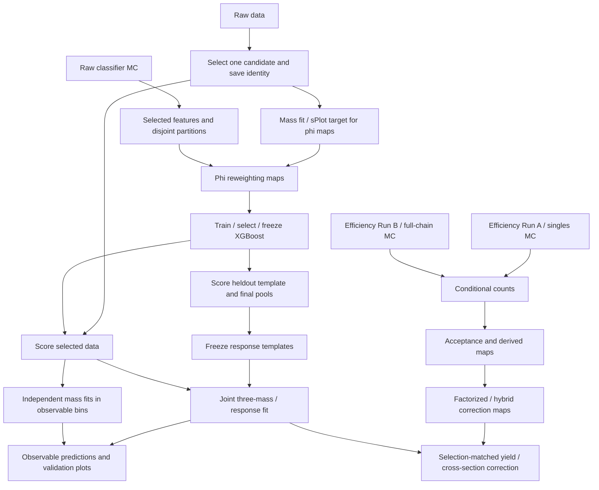

# Unified analysis interface and execution graph

The interface/orchestration implementation was added on 2026-11-17; see
[Interface implementation](#interface-implementation-2026-11-17) and the runnable
examples in `configs/analysis/`. The design sections below retain the original
proposal and historical integration inventory. Separate Run A/B populations
require explicit compatible map population selection; their automatic scientific
combination remains outside the implemented orchestration. The differential-yield
plot change is implemented separately. Read alongside
`Real_Data_Mass_Classifier_Workflow.md`, `Classifier_Plotting_Interface_20261109.md`
and `Efficiency_Evaluation_Guideline.md`.

## What is integrated today

The five referenced tasks were read. Their current artifacts establish the
21-input, six-class, native φ-reweighted baseline, fixed 54 response categories,
mass-extracted observable distributions, fixed-count closure reports, and the
eight-variable real-data comparison. These are distinct inference/validation
products, rather than interchangeable versions of one fit.

| Area | Existing entry point / shared implementation | Integration status |
|---|---|---|
| Data selection, mass fit, sPlot | Root-level compatibility launchers; `scripts/kinematics/`; `ntuple_pipeline_common.py` | Existing framework; shared candidate selection is also used by classifier extraction |
| Full-correlation XGBoost | `scripts/templates/train_full_correlation_xgboost.py` | Uses shared selection; owns its own extraction/cache, maps, training, tuning and output conventions |
| Classifier diagnostics | `plot_full_correlation_validation.py`, `plot_full_correlation_classification_metrics.py` | Can use saved predictions/metrics; separate CLIs and partly script-local imports |
| Joint mass/response inference | `scripts/templates/run_mass_classifier_workflow.py` | Reuses the original mass components through `response_mass_fit.py` → `scripts.kinematics.fit_splot.build_jjp_mass_components` |
| Observable validation | `mass_classifier_observables.py`, `prepare_meeting_observable_plots.py` | Reusable extraction and rendering, but fit orchestration/report assembly remain separate |
| Latest fixed-mixture data comparison | `subprocess_efficiency_derived_20261108/mass_classifier_fixed_mixture_comparison_20261116/*driver.py` | Important common-normalization/continuation logic still lives in result directories |
| Acceptance / efficiency | `run_efficiency.py`, `efficiency_workflow/cli_efficiency.py`, rebuild/merge/derived/factorized-map scripts | Established configurable pipeline; not a dependency of classifier training |
| Efficiency + validation execution | `scripts/efficiency/plot_validation.py` → `Makefile.validation` | Real Make graph already exists for seven validation groups; no train/response-fit targets |
| Six-source correction / cross sections | `mass_classifier_normalization.py`, `run_normalization()` | Explicit arrays/config adapter exists; does not automatically consume the production efficiency-map products |
| Meeting bundles | `meeting_report_20261112`, `meeting_report_fixed_counts_20261112` | Portable snapshots containing copied code; not the canonical runtime implementation |

There is no repository-wide CLI/package entry point. Much of the classifier
implementation is still untracked in the current worktree. It is usable local
code, but a clean checkout will not reproduce it until that work is included.

The current efficiency code is further along than some historical guidance:
its CLI defaults to automatic `X_data` / `mkcands/X_data` detection, has a
versioned strict efficiency configuration, and implements single-object branch
paths with rapidity computed from momentum/mass when needed. The proposal
should preserve this implementation, not restart an old composite-only design.

## Recommended public interface

Use a small Python package, `ntuple_analyzer`, as the single public entrance.
Keep numerical implementations in their existing modules initially. Load ROOT,
XGBoost and plotting dependencies lazily in stage adapters. Existing launchers
can continue forwarding to those adapters during migration.

Proposed usage, not commands available today:

```bash
source /cvmfs/sft.cern.ch/lcg/views/LCG_109a/x86_64-el9-gcc13-opt/setup.sh
# Inspect dependencies; then execute only missing/stale prerequisites.
python3 -m ntuple_analyzer --config configs/analysis/jjp.yaml plan --target validation
python3 -m ntuple_analyzer --config configs/analysis/jjp.yaml run --target validation --jobs 2
# Explicit single-stage execution uses the same configuration and adapters.
python3 -m ntuple_analyzer --config configs/analysis/jjp.yaml stage train
python3 -m ntuple_analyzer --config configs/analysis/jjp.yaml stage fit
python3 -m ntuple_analyzer --config configs/analysis/jjp.yaml stage acceptance
python3 -m ntuple_analyzer --config configs/analysis/jjp.yaml stage plot
```

`run` invokes Make; `stage` executes one adapter and never recursively invokes
Make. `plan` previews the same graph. A small optional `status` command should
read saved manifests and distinguish missing, running, failed, partial and
accepted results. A successful process exit alone does not establish fit
acceptance: the existing workflow can write `partial` status and return normally.

Keep stage-specific settings in one versioned configuration; permit a small
set of explicit overrides such as output run, target and worker count. Save the
resolved configuration per run. Use public channels `JJP`, `JYP`, `JJY`, but
reject unsupported channel/stage combinations: the six-source classifier and
current efficiency implementation are JJP-specific. Translate `JJP` to the
existing internal `JpsiJpsiPhi` analysis mode in its adapter.

Example configuration shape (proposed):

```yaml
schema_version: ntuple-analyzer-analysis/v1
channel: JJP
run_dir: runs/jjp_baseline_v1
inputs:
  selected_data: {path: ../jjp_data_selected.root, schema: legacy_selected}
  data_selection_manifest: configs/analysis/jjp_data_selection.json
  classifier_mc_manifest: configs/analysis/jjp_classifier_mc.json
  efficiency_run_a_manifest: configs/analysis/jjp_singles_mc.json
  efficiency_run_b_manifest: configs/analysis/jjp_fullchain_mc.json
classifier:
  preset: full_correlation_21
  baseline: phi_reweighted_native
  class_order: [DPS1, DPS2_CS, DPS2_G, SPS_CS, SPS_G, TPS]
  seed: 20261109
  response: {preset: argmax_tps_sumdps_54_v1}
fit:
  mode: data
  mixture: fitted  # alternative: fixed, with explicit fractions and provenance
  mass_config: configs/analysis/jjp_mass.json
  observables: [dr_jj, dphi_j1phi, dy_jj, m_jj, pt_jjp, pt_jj, dphi_jj, dphi_j2phi]
  observable_bins: 8
efficiency:
  config: configs/efficiency/tps_nominal.yaml
  correction_mode: factorized
plots:
  normalization: differential_yield
  cms_caption: Work In Progress
```

The response preset must serialize the actual argmax/TPS-score/summed-DPS-score mapping,
boundaries, endpoint conventions, smoothing floor and class order; the integer
54 alone is not a specification. Currently this is six argmax labels × three
TPS-score bins × three summed-DPS-score bins, with implementation edges
`[0, .2, .5, 1.000001]` (the upper sentinel includes score 1). Model manifests record the ordered feature
names and definitions. Replace `load_study()`'s hard-coded 21-feature check with
manifest compatibility validation when adding alternative training presets.
An eight-input comparison is then a separate run, with its own model/templates,
not an override applied to the frozen baseline. A proposed three-coordinate
response needs its own definition and closure study; it cannot be inferred just
from requesting six output classes.

Adapter sketch (not implemented):

```python
def execute_stage(name, resolved):
    # Each adapter validates its declared inputs and publishes declared outputs.
    if name == "train":
        from .adapters.classifier import train
        return train(resolved.classifier, resolved.inputs, resolved.run_dir)
    if name == "efficiency":
        from .adapters.efficiency import calculate
        return calculate(resolved.efficiency, resolved.inputs, resolved.run_dir)
    # Additional adapters: select, features, reweight, templates, fit,
    # observable-fit, acceptance, maps, correct, validation, plot.
    raise ValueError(f"Unknown stage: {name}")
```

Prefer direct Python APIs with `main(argv=None)` wrappers as adapters mature.
Initially, subprocess adapters can invoke the existing scripts with argument
lists and check their saved status, avoiding global `sys.argv` mutation. A
subprocess boundary is also useful for isolating RooFit's process-global state.

## Dependency graph and statistical boundaries



The baseline's historical reweighting and splits stay frozen when replotting.
For a new training run, map fitting/tuning must respect a declared partition
policy; final-validation labels should not drive model or response selection.
The graph makes dependencies visible but does not by itself enforce independence.

Keep these contracts explicit:

1. **Schema and selection.** New raw ntuples use `X_data`, unprefixed vector
   candidates; legacy selected ROOT uses scalar `selected`/`sel_*`. The existing
   data adapter requires scalar candidates even when its tree default is
   `X_data`: changing a tree name is not raw-candidate selection. New raw inputs
   need the selection stage, with real event identity, best-candidate index,
   coherent J/ψ pT ordering and rapidity calculated from momentum/mass.
2. **Weight meaning.** Balanced training weights, native φ-shape weights,
   sWeights, and efficiency weights are different fields. Use unweighted
   measured masses for the joint data likelihood. Do not feed width-normalized
   histogram heights into the likelihood or renormalize each observable to its
   separately extracted total. Classifier features use nominal object masses;
   the likelihood uses measured masses.
3. **Two types of fit.** The joint 54-category fit estimates six yields. The
   independent observable fits estimate one signal yield per observable bin.
   The fixed-mixture comparison instead uses user-declared fractions and one
   inclusive normalization; that mode must not appear as a fitted composition.
   Promote its result-directory drivers into tested adapters, including the
   recorded bounded continuation policy, without relaxing acceptance thresholds.
4. **Efficiency compatibility.** Production efficiency maps and classifier MC
   currently use different selections. The classifier's selector explicitly
   does not add the production HLT/DiOnia/Pri and kaon-quality cuts. Matching a
   channel label is insufficient. Add a bridge validating selection ID, endpoint,
   GEN denominator, axes/folding, class order, generated exposures and uncertainty
   scope before passing production products into six-source normalization.
   Acceptance is a derived view of the conditional counts, not a second raw scan.
5. **Correction meaning.** RECO fitted fractions cannot be used directly as GEN
   mixture weights: production mixing already has the explicit normalization
   `N_c / (epsilon_c * generated_total_c)`. Preserve per-source conditional
   numerators/denominators and covariance. A product of mixed conditional
   efficiencies needs consistent populations/conditioning; independent marginal
   maps cannot silently establish full event-efficiency factorization.
6. **Validation status and covariance.** Keep numerical acceptance separate from
   heldout closure and inference validity. The referenced data six-yield fit was
   not accepted; fixed-mixture plots cannot promote it. Carry shared normalization,
   template/map uncertainty and Y–prediction cross covariance when available.
   Existing conditional-only errors remain explicitly conditional. Fixed-count
   closure uses actual injected counts. Cross-section output requires matching
   efficiency, luminosity/branching conventions and their covariance inputs.
7. **Presentation.** Plotting consumes saved numbers only. Changes to labels,
   bin-width normalization or styles must not retrain, refit, recalibrate maps or
   rescan EOS. Response-category indexes and categorical yield summaries do not
   represent a continuous differential observable. Efficiency ratios are already
   dimensionless; do not divide them by widths.

## Why GNU Make fits this repository

| Choice | Fit here |
|---|---|
| GNU Make + Python CLI/adapters | Recommended now: installed Make 4.3, an existing graph, local file artifacts, dry runs, incremental rebuilds and bounded parallel jobs |
| Snakemake | Worth revisiting for large parameter/sample matrices and direct batch-executor integration; adds a runtime/deployment dependency and workflow language |
| Custom Python DAG scheduler | Avoid: duplicates scheduling, timestamp handling, interruption recovery and dry-run logic |

Use a top-level Makefile including domain fragments (`workflow/classifier.mk`,
`efficiency.mk`, `validation.mk`); migrate `Makefile.validation` incrementally.
The Python CLI resolves the config and supplies the run path. Make schedules
artifacts; Python owns scientific validation and configuration interpretation.
Do not generate a huge shell command language inside YAML.

Proposed Make fragment, illustrating a grouped multi-output training rule:

```make
SHELL := /bin/bash
.SHELLFLAGS := -e -o pipefail -c
.DELETE_ON_ERROR:
LCG ?= /cvmfs/sft.cern.ch/lcg/views/LCG_109a/x86_64-el9-gcc13-opt/setup.sh
PYTHON ?= python3
# CONFIG, RUN and per-stage prerequisite lists are resolved by the CLI.
TRAIN_OUT := $(RUN)/model/model.json $(RUN)/model/manifest.json

$(TRAIN_OUT) &: $(RUN)/features/manifest.json $(RUN)/weights/manifest.json \
                $(RUN)/config/train.json $(TRAIN_CODE)
	source "$(LCG)" && $(PYTHON) -m ntuple_analyzer --config "$(CONFIG)" stage train

.PHONY: training
training: $(TRAIN_OUT)
```

Technical details that affect correctness:

- Declare real outputs, using grouped `&:` rules for one invocation producing
  multiple files. A manifest alone is insufficient if its PNG/parquet children
  can be deleted. Declare stable output sets or validate listed outputs before
  accepting a stage as current. Existing validation code already has a partial
  solution in `invalidate_incomplete_stepwise()`.
- Stage adapters write into a temporary sibling directory, validate required
  files and accepted/partial status, then publish a fresh completed stage.
  Preserve failed RooFit workspaces/attempt logs separately. `.DELETE_ON_ERROR`
  does not clean partial multi-file directories. New run directories avoid
  collisions with existing scripts' intentional non-overwrite behavior.
- Track the relevant imported implementation/config files, not just a launcher
  script. Save resolved per-stage configuration files; update them only when
  their contents change, so style edits invalidate plots but not training.
  Freeze class/feature/response ordering in artifact manifests.
- Make cannot track remote XRootD mtimes reliably or notice changed Python
  options. Remote file lists and source identity belong in frozen input
  manifests. Refreshing that inventory is explicit; `make -n` must not scan EOS.
- Keep one writer per stage directory. Bound both Make parallelism and each
  stage's XGBoost/ROOT thread count to avoid `make -j` multiplied by internal
  threads. Keep independent RooFit work in separate processes.
- Condor submission is not stage completion. Existing shard machinery should
  publish validated completion artifacts after retrieval/merge. Do not mark
  an asynchronous submit command as a completed map dependency.
- Avoid cache-dependent graph definitions tied to one developer's paths. The
  existing validation Makefile has dated defaults and wildcard cache selection;
  resolve external reusable artifacts explicitly in the run configuration.

## Suggested implementation order

1. Add the CLI/config resolver and adapters for existing operations. Preserve
   numerical behavior and make the current 21-input workflow reproducible from
   a clean checkout. Migrate essential result-directory drivers into the source.
2. Split training's extraction/reweight/train/score stages at existing function
   boundaries, then make the model/response contract manifest-driven. Split the
   joint fit, observable extraction and plotting into independently callable
   stages. Keep the frozen study as a regression reference.
3. Add Make rules and stage publication/status checks, starting with the bounded
   training → template → fit → plot path. Test that a second run does no work,
   a style edit rebuilds plots only, deleted outputs rebuild, and a rejected fit
   cannot satisfy downstream correction targets.
4. Bridge production efficiency products to six-source normalization after
   selection/denominator compatibility is demonstrated. Add closure targets
   before enabling a full physics-result target.

## Implemented now: differential-yield plots

`mass_classifier_observables.plot_signal_mixture()` now renders
`Y_b / delta_x_b`, stacked `N_c T_bc / delta_x_b`, and uncertainty bands in the
same units. Density covariance is `V_ij / (delta_x_i delta_x_j)`; asymmetric
error endpoints are scaled per bin. Original integrated fields are retained.
Ratios, support thresholds and statistical summaries still use integrated
yields. The JSON also records `differential_yield` and bin widths.

Fresh outputs are in `differential_yield_20261117/`: eight latest data comparisons
and 54 preferred historical toy distributions from the canonical meeting bundle.
The finite endpoint bins keep the original folding of out-of-range events;
their heights are folded-bin average densities, not resolved tail measurements.

Available command today, using only saved JSON:

```bash
source /cvmfs/sft.cern.ch/lcg/views/LCG_109a/x86_64-el9-gcc13-opt/setup.sh
python3 scripts/templates/replot_signal_mixtures.py \
  --input-dir subprocess_efficiency_derived_20261108/mass_classifier_fixed_mixture_comparison_20261116/fine8_continuation/plots \
  --output-dir /tmp/chiw/jjp_differential_data_fresh
python3 scripts/templates/replot_signal_mixtures.py \
  --input-dir meeting_report_20261112/distributions \
  --pattern '*/preferred/*/signal_mixture.json' \
  --output-dir /tmp/chiw/jjp_differential_meeting_fresh
```

New fit outputs save asymmetric signal errors for exact replotting. Old JSON
without saved errors uses its signal covariance diagonal, as in the selected
legacy displays; this source is recorded in regenerated JSON. No fits or
retraining are needed for this presentation change.

## Interface implementation (2026-11-17)

`python3 -m ntuple_analyzer` now provides `plan`, `run`, `stage` and `status`.
The top-level Makefile forwards named targets to that interface; each run stores
its generated Make graph, resolved configuration and stable per-stage slices.
Adapters preserve existing numerical implementations. Their `stage_spec`
declares inputs, outputs, imported implementation files and dependencies;
`execute` writes a fresh staging directory. The publisher validates artifacts,
archives earlier owned generations and preserves rejected attempts separately.
Only accepted stages receive `.complete.json`; every produced child is listed.
A later rejected rebuild cannot expose an older completion as current.

The runnable `configs/analysis/jjp.yaml` is an explicit saved-data plot profile.
Its `inputs.fit_results` reference prunes the training and fit graph. The
configuration is a local baseline example, not a portable claim that the
untracked historical products exist in every checkout. `plan` and `status`
create no files and do not inspect remote ROOT data. `run` performs incremental
Make execution. Per-stage configuration dependencies avoid making all stages
depend on the original YAML timestamp.

```bash
source /cvmfs/sft.cern.ch/lcg/views/LCG_109a/x86_64-el9-gcc13-opt/setup.sh
python3 -m ntuple_analyzer --config configs/analysis/jjp.yaml plan --target plots
python3 -m ntuple_analyzer --config configs/analysis/jjp.yaml \
  --run-dir /tmp/chiw/jjp_saved_plots run --target plots --jobs 1
```

Input paths are relative to the YAML file; external reusable artifacts may be
strings or `{path: ...}` records. Result-directory overlap is rejected. Existing
selected scalar inputs require explicit schema/selection identity; changing the
tree name does not adapt raw vector candidates. The new adapters retain the
single-object efficiency implementation and validate six-source correction
compatibility rather than inferring it from a channel name. Full physics
production remains conditional on the selection, denominator and closure
contracts above; successful orchestration alone does not certify a result.

### Independent plot units and axis scales

The saved-result adapter accepts `plots.plot_height_per_unit_interval` (default
`true`) independently of `plots.plot_axis_scaling: {x: linear, y: linear}`.
Scales accept `linear` and `log`. `plots.observables.NAME` may override the height
flag or either axis, with omitted fields inherited from global settings. Display
changes remain confined to the plot configuration slice and saved-result stage.

Density heights always use the original linear bin widths, even on log x; no
logarithmic Jacobian, rebinning or bin removal is applied. The ratio shares the
same x scale. Negative edges reject log x; a zero first edge requires an explicit
positive display minimum. The eight named
pair/system pT and mass overrides are recorded in the two
`configs/analysis/jjp_plot_scaling_*.yaml` profiles. Existing saved bundles lack
`pt_j1phi` and `pt_j2phi`; these settings do not substitute individual J/psi pT
or trigger new extractions. The 62 saved distributions can therefore be rendered
coherently with 15 available requested log-x plots and 47 default linear-x plots.

`plot_axis_limits` adds optional `x_min`, `x_max`, `y_min`, and `y_max` display
bounds, partially inherited per observable. An explicit positive `x_min` permits
a zero first saved edge on log x, clipping only the display while retaining the
full original bin width. Negative edges are rejected. Log y requires a positive
explicit `y_min` on the main distribution only; its lower error segments and
bands clip at that display boundary, while nonpositive centers omit markers and
remain in numerical arrays. Statistical limit arrows require supplied
`signal_upper_limits` records (`null` or `{value, confidence_level, method?}`);
clipped ordinary intervals never create limits. The fresh log-display profiles
retain linear y for the saved 62-distribution gallery and produce no companion
renderings or additional inference.
